# Victory Youth

[](https://victory-youth.bswd.workers.dev)

**Live website:** https://victory-youth.bswd.workers.dev

[](https://github.com/SandeepAi369/victory-youth/actions/workflows/ci.yml)
[](https://github.com/SandeepAi369/victory-youth/actions/workflows/codeql.yml)
[](LICENSE)


[](CONTRIBUTING.md)
[](https://github.com/SandeepAi369/victory-youth/labels/good%20first%20issue)

An open-source **community, festival and donation management platform**, built for **Victory Youth Association** (Gudem Gally, Banswada, Telangana) and usable by any youth group, temple committee or small NGO. It runs a whole festival season end to end: chanda and donation collection with transparent public totals, committee members and their contributions, events and pooja schedules, notices, a photo gallery and receipts, all managed from one private admin panel.

It is designed to run **for years on free tiers**: Next.js on Cloudflare Workers, Turso for core records, Cloudflare D1 for media metadata and Cloudinary for images.

**Try it in one command, no accounts needed:**

```bash
git clone https://github.com/SandeepAi369/victory-youth.git && cd victory-youth
npm install && npm run demo
```

---

## Contents

- [Why this project](#why-this-project)
- [Screenshots](#screenshots)
- [Features](#features)
- [Architecture](#architecture)
- [Tech stack](#tech-stack)
- [Getting started](#getting-started)
- [Deployment](#deployment)
- [Project structure](#project-structure)
- [Roadmap](#roadmap)
- [Contributing](#contributing)
- [License](#license)

---

## Why this project

Community festivals in India collect money from hundreds of people: monthly chanda, one-off donations, committee contributions. That money is usually tracked in notebooks and WhatsApp groups. This project makes it **transparent without exposing anyone**:

- **Every rupee is itemized**: each payment is its own entry with a date and receipt, never merged or overwritten.
- **Public totals people can trust**: one clear total per category and year, summed in the database.
- **Privacy by default**: anonymous contributors never appear on the public site in any form, and phone numbers and addresses never leave the database.
- **Zero running cost**: everything fits in free tiers, so a volunteer group can run it for years.

---

## Screenshots

| Home | Chanda (one row per person) | Contributor history | Committee |
|---|---|---|---|
| 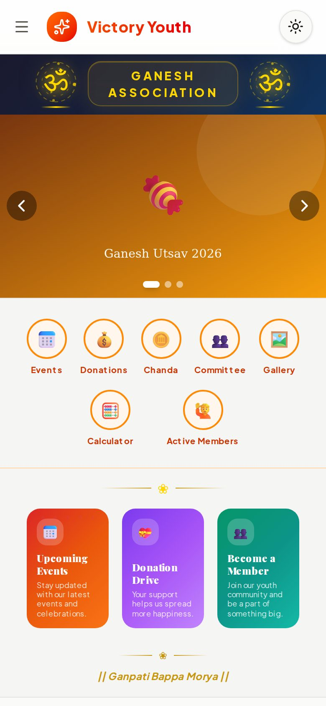 | 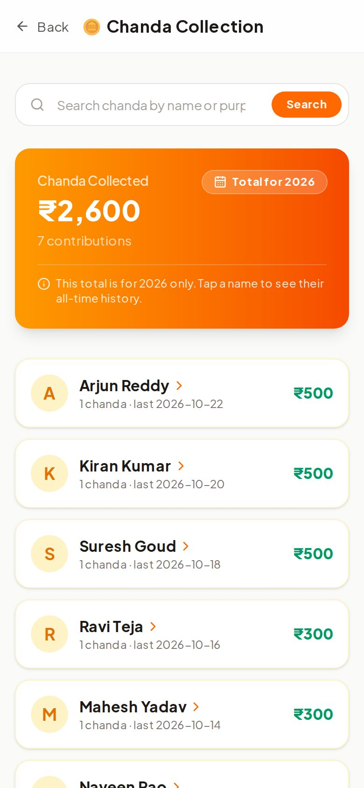 | 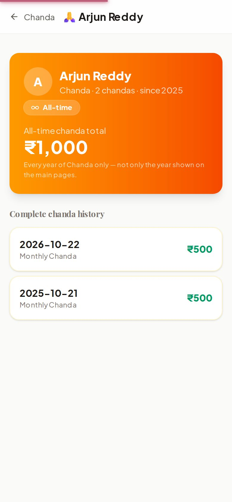 | 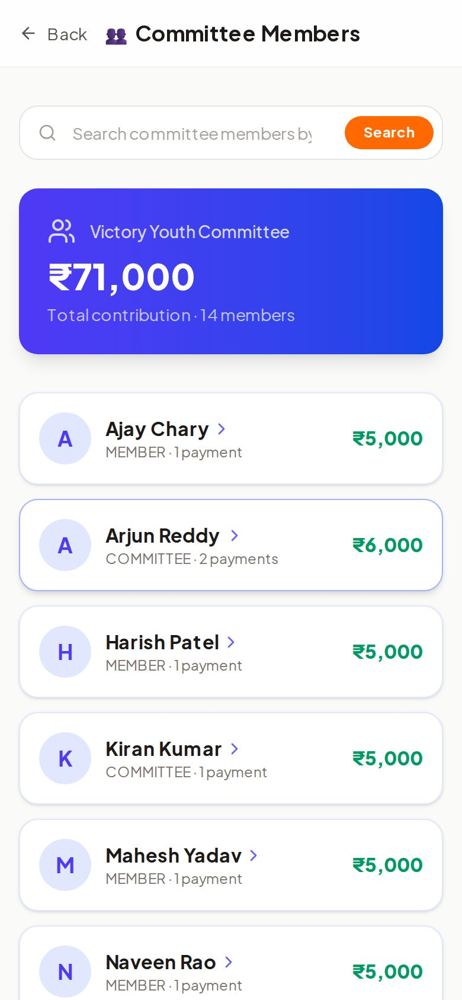 |

| Admin dashboard | Admin: Chanda list | Admin: contributor profile | Calculator |
|---|---|---|---|
| 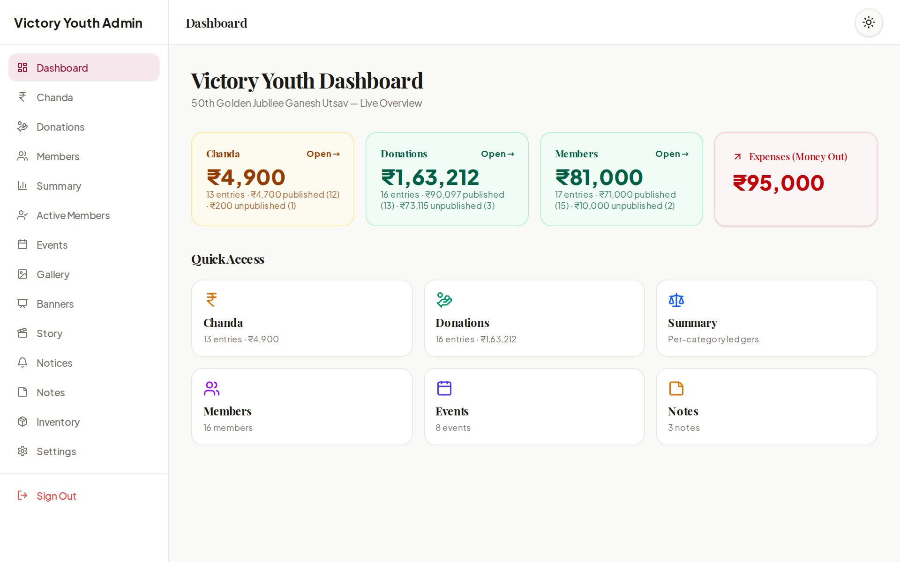 | 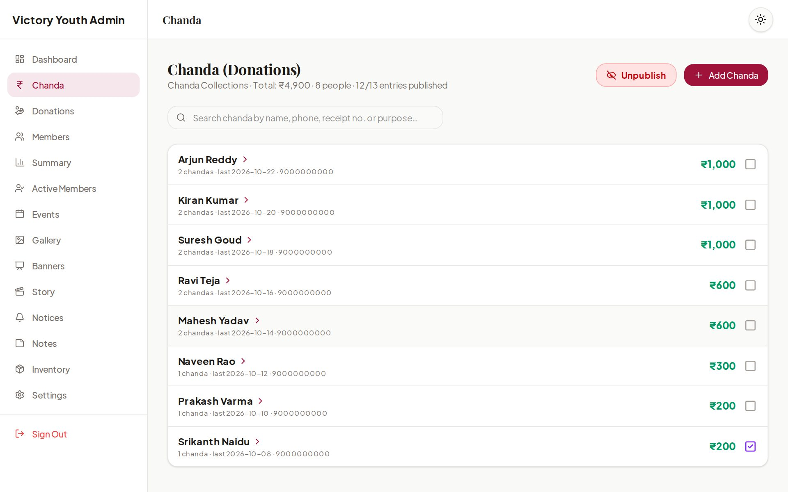 | 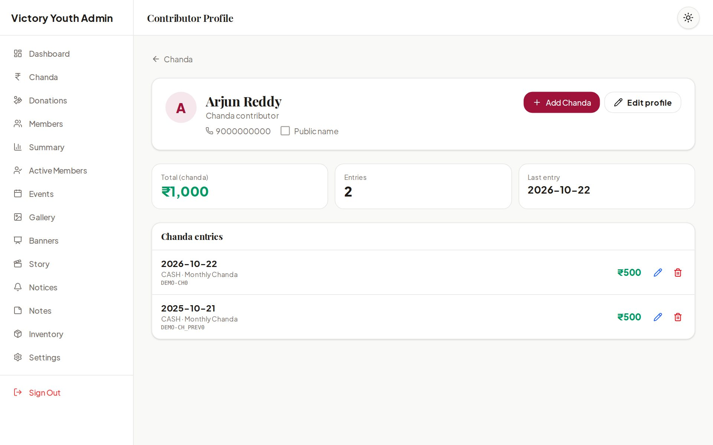 | 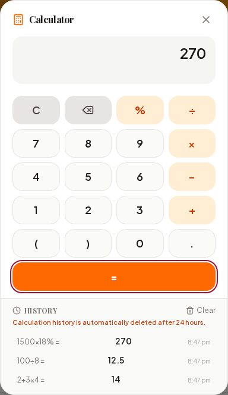 |

<sub>Screenshots are from `npm run demo`: all names, numbers and images are fictional.</sub>

---

## Features

### Money sections: Chanda, Donations and Committee (Members)

The three money sections follow the same rules and are **fully independent**: separate profiles, totals, search and settings, never mixed.

- **One row per person.** Public and admin lists show each contributor once, with their number of contributions, last date and total. A `›` arrow opens their profile.
- **Itemized history.** A person's profile lists every payment separately (date, purpose, amount, receipt). Adding money to an entry creates a **new** dated entry; amounts are never merged or overwritten.
- **Dates are set by the server** (India time), not typed by hand.
- **Year-wise visibility.** Admins choose which years are public (default: the current year). Every public total is labelled, for example "Total for 2026", and public profiles show the all-time history.
- **Anonymous = admin-only.** Ticking a contributor anonymous removes them from the public site completely (no "Anonymous" rows or totals), and their entries cannot be published until unticked.
- **One Publish / Unpublish button per section.** New entries follow the section's state, so admins never toggle entries one by one.
- **Simple add form.** Name, phone, amount. Existing people in the same section are suggested while typing.

### Public site
- **Home page** with hero carousel, banners, quick links, donation progress (labelled by year) and recent donors.
- **Category search** on every list page (shareable `?q=` links, works without JavaScript).
- **Events and schedule**: day-by-day programme with timings, locations and people in charge.
- **Donation receipts** (`/receipt/<id>`) with a downloadable 80G receipt PDF.
- **Member ID verifier**: look up an active member and download a printable ID card (PDF with QR code).
- **Photo gallery** grouped month by month, plus a public **Active Members** list.
- **Calculator** with a history that deletes itself after 24 hours (stored only in the visitor's browser).
- **Light and dark mode**, responsive on every screen size.

### Admin panel (`/admin`)
- **Dashboard and Summary** with separate ledgers for Chanda, Donations and Members (published/unpublished amounts, totals by payment mode) plus expenses.
- **Full-page profiles** for every contributor and member: details, totals and every entry with Edit and Delete. Lists stay clean, with no buttons on the rows.
- Manage **events, notices, notes, gallery, banners, hero images, inventory** (Excel export) and association **settings** (80G, UPI and bank details shown to donors).
- **Instant search** on every admin list.
- Image uploads go **directly from the browser to Cloudinary**; the database stores only the URL and id.

### Security
- Single admin password (`ADMIN_PASSWORD`, at least 12 characters) with **no fallback**: without it, admin login is disabled.
- **Signed, expiring, httpOnly session cookie** (HMAC-SHA256). Changing the password signs out every session.
- **Every admin server action and admin API route checks the session.** Money actions are also checked against their category on the server.
- Public queries select only the columns a page shows and **exclude anonymous entries inside SQL**. All credentials come from environment variables or Worker secrets. See [SECURITY.md](SECURITY.md).

### Developer experience
- **`npm run demo`**: the whole site with realistic fake data, entirely local.
- **`npm run setup`**: one-command setup, fully local (`--local`) or in the cloud (creates the Turso and D1 databases for you).
- **CI on every pull request**: lint, type check and a full Cloudflare Workers build. **CodeQL** security scanning and **Dependabot** updates.
- Strict TypeScript, no `any`, zero lint problems.

---

## Architecture

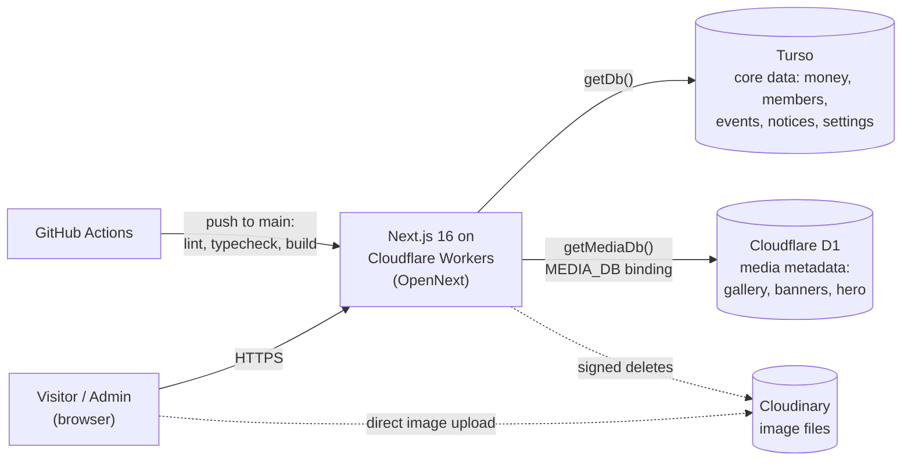

Each query uses the database that owns its table; there are no joins across the two. In local development the core database is a plain SQLite file and D1 runs as a local copy.

### Data model of the money sections

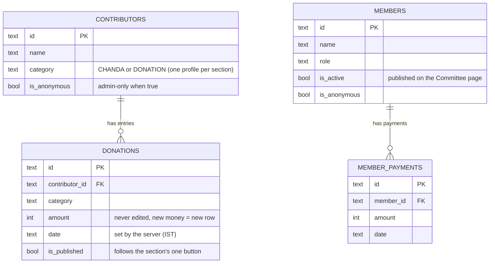

### When does an entry appear on the public site?

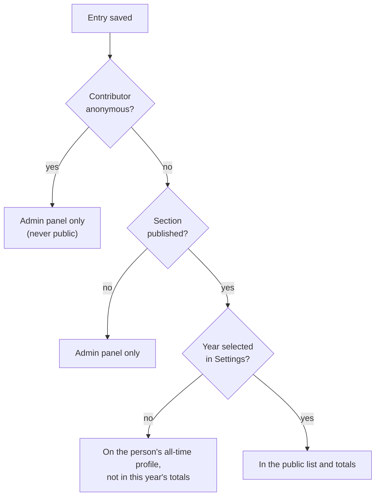

---

## Tech stack

| Layer | Technology |
|---|---|
| Framework | [Next.js 16](https://nextjs.org) (App Router, Server Actions), React 19, TypeScript |
| Hosting | [Cloudflare Workers](https://workers.cloudflare.com) via [OpenNext](https://opennext.js.org/cloudflare) |
| Core database | [Turso](https://turso.tech) (libSQL / SQLite): 22 tables for money, members, events, notices, settings and more |
| Media database | [Cloudflare D1](https://developers.cloudflare.com/d1/): 5 tables for gallery, banners, hero images and documents |
| ORM | [Drizzle ORM](https://orm.drizzle.team) + drizzle-kit migrations |
| Images | [Cloudinary](https://cloudinary.com) (unsigned browser uploads, signed server-side deletes) |
| UI | Tailwind CSS 4, Framer Motion, Lucide icons |
| Documents | jsPDF (receipts and ID cards), SheetJS (Excel export) |
| CI/CD | GitHub Actions: CI on pull requests, CodeQL, Dependabot, `wrangler deploy` on every push to `main` |

---

## Getting started

**Prerequisite:** Node.js 22+.

### Option A: Demo (fake data, no accounts)

```bash
npm install
npm run demo          # → http://localhost:3000, admin password: demo-admin-password
```

Everything lives in `.demo/` and never touches a real database.

### Option B: Local development (no accounts)

```bash
npm install
npm run setup -- --local   # local SQLite core DB + local D1, writes .env
npm run dev
```

### Option C: Cloud (your own Turso + Cloudflare)

Needs free accounts at [Turso](https://turso.tech), [Cloudflare](https://dash.cloudflare.com) and (for uploads) [Cloudinary](https://cloudinary.com), plus the [Turso CLI](https://docs.turso.tech/cli/introduction).

```bash
turso auth login && npx wrangler login
npm run setup              # creates both databases, writes .env and wrangler.jsonc, creates the tables
npm run dev
```

Add `--dry-run` to see exactly what it would do first. Existing `.env` values are never overwritten. All variables are documented in [`.env.example`](.env.example).

Browser uploads use an **unsigned Cloudinary upload preset**: set `NEXT_PUBLIC_CLOUDINARY_CLOUD_NAME` and `NEXT_PUBLIC_CLOUDINARY_UPLOAD_PRESET` (or edit the defaults in `src/lib/cloudinary-config.ts`).

### Useful scripts

| Script | What it does |
|---|---|
| `npm run demo` | Local site with fake data (`-- --seed-only` to only build the data) |
| `npm run setup` | One-command setup (`-- --local`, `-- --dry-run`, `-- --yes`) |
| `npm run dev` | Next.js dev server (with Cloudflare bindings through OpenNext) |
| `npm run preview` | Build for Workers and run locally with `wrangler dev` |
| `npm run deploy` | Build for Workers and deploy with `wrangler deploy` |
| `npm run db:generate` | Generate SQL migrations for both databases |
| `npm run db:push` | Apply the schema to Turso (core) and D1 (media) |
| `npm run db:media:local` | Apply the media schema to the local D1 copy |
| `npm run lint` / `npm run typecheck` | ESLint / TypeScript checks (both run in CI) |

---

## Deployment

Every push to `main` is linted, type-checked and deployed automatically by GitHub Actions (`.github/workflows/deploy.yml`).

1. Add a repository secret **`CLOUDFLARE_API_TOKEN`** (Settings → Secrets and variables → Actions) and set your account ID in `deploy.yml`.
2. Set the runtime secrets on the Worker once:

```bash
npx wrangler secret put TURSO_CORE_DATABASE_URL
npx wrangler secret put TURSO_CORE_AUTH_TOKEN
npx wrangler secret put ADMIN_PASSWORD
npx wrangler secret put CLOUDINARY_CLOUD_NAME
npx wrangler secret put CLOUDINARY_API_KEY
npx wrangler secret put CLOUDINARY_API_SECRET
```

The media database needs no secret: the Worker reaches D1 through the `MEDIA_DB` binding in `wrangler.jsonc`.

---

## Project structure

```
src/
├── app/
│   ├── (public pages)       # /, /chanda, /donations, /members, /contributor/[id], /members/[id], …
│   └── admin/               # admin panel: lists, /admin/contributors/[id], /admin/members/[id], settings
├── components/
│   ├── admin/               # ContributionsAdmin, ContributionForm, ProfileForm, controls
│   └── public/              # PersonRow, ContributionTotals, search, carousels, calculator
├── db/
│   ├── index.ts             # getDb() → Turso, getMediaDb() → D1
│   ├── schema-core.ts       # 22 core tables (Turso)
│   └── schema-media.ts      # 5 media tables (D1)
└── lib/
    ├── actions/             # server actions (contributors, settings), all behind requireAdmin()
    ├── queries/             # public.ts (privacy-safe public reads), ledger.ts (admin ledgers)
    ├── admin-session.ts     # signed admin sessions + requireAdmin()
    └── contributions.ts     # categories, payment modes, IST dates, year labels
scripts/                     # setup.mjs, demo.mjs (plain Node)
drizzle/                     # generated SQL migrations (core/ and media/)
docs/screenshots/            # README images (from npm run demo)
```

---

## Roadmap

Ideas we would love help with. Each has an issue, and many are tagged **good first issue**:

- Telugu translations for the public site
- An expenses (money-out) page in the admin panel
- Automated end-to-end tests in CI (Playwright, against `npm run demo`)
- Accessibility audit of the public pages
- Unit tests for the calculator and contribution helpers

See all [open issues](https://github.com/SandeepAi369/victory-youth/issues) and the [good first issues](https://github.com/SandeepAi369/victory-youth/labels/good%20first%20issue).

---

## Contributing

Contributions are welcome! Start with `npm run demo`, then read [CONTRIBUTING.md](CONTRIBUTING.md). Questions and ideas go to [Discussions](https://github.com/SandeepAi369/victory-youth/discussions). Please report security issues privately (see [SECURITY.md](SECURITY.md)). Everyone taking part follows the [Code of Conduct](CODE_OF_CONDUCT.md).

## License

Released under the [MIT License](LICENSE) © 2026 Sandeep CH.
