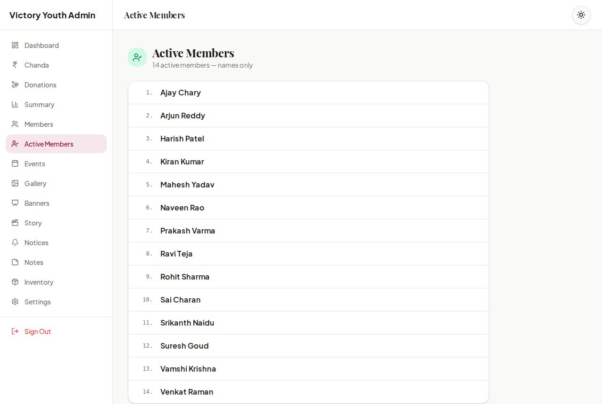

# Victory Youth

[](https://github.com/SandeepAi369/victory-youth/actions/workflows/ci.yml)
[](LICENSE)


A modern community, youth-impact and donation management platform for **Victory Youth Association** (Gudem Gally, Banswada, Telangana), built to run a festival season end to end: events and pooja schedules, donations and chanda collection, members and ID cards, notices, a photo gallery, all managed from one private admin panel.

It is designed to run for years on free tiers: **Next.js** on **Cloudflare Workers**, **Turso** for core records, **Cloudflare D1** for media metadata, and **Cloudinary** for the images themselves.

**Try it in one command, no accounts needed:**

```bash
git clone https://github.com/SandeepAi369/victory-youth.git && cd victory-youth
npm install && npm run demo
```

---

## Screenshots

| Home screen | Calculator (history auto-deletes after 24 h) | Admin panel |
|---|---|---|
|  |  |  |

<sub>Screenshots are from `npm run demo`: all names, numbers and images are fictional.</sub>

---

## Features

### Public site
- **Home page**: hero carousel, banners, live totals (members, donations, events), notices and recent donations.
- **Calculator**: opens from the quick-link icons. Safe expression evaluator (+ − × ÷, %, brackets), keyboard support, and a history that **automatically deletes itself after 24 hours** (stored only in the visitor's browser).
- **Category search** on every list page: Donations, Chanda, Committee, Events, Notices and Notes each have their own search box (shareable `?q=` links, works without JavaScript).
- **Events & schedule**: day-by-day pooja and event programme with timings, locations and people in charge.
- **Donations & chanda**: published donor lists and running totals. Entries only appear once an admin publishes them, and donors marked **Anonymous** are always shown as "Anonymous Devotee". The real name never leaves the database for public pages, and search cannot find it either.
- **Donation receipts**: shareable receipt page (`/receipt/<id>`) with a downloadable 80G receipt PDF. Only successful transactions get a receipt.
- **Member ID verifier**: look up an active member by exact member ID or phone number and download a printable ID card (PDF with QR code). Phone numbers are masked unless the visitor searched by that number.
- **Photo gallery** grouped **month by month**, newest first, with each photo's date.
- **Active Members**: a public, searchable list of names only, showing just the members an admin has published.
- **Light and dark mode**, responsive on every screen size.

### Admin panel (`/admin`)
- Manage **members**, **donations**, **chanda**, **events**, **inventory** (with Excel export), **notices**, **notes**, **gallery**, **banners** and **hero images**.
- **Instant search** on every admin list.
- **Active Members** view: just the names of active members, each with a **Published / Draft** switch that controls the public list.
- **Master financial summary** across donations, sponsors and auctions.
- **Association settings**: name, registration and 80G numbers, contact details, and UPI / bank details shown to donors.
- Publish / unpublish switches on most content, so nothing goes live until it is ready, plus an **Anonymous** switch per donation.
- Image uploads go **directly from the browser to Cloudinary**; the database stores only the `secure_url` and `public_id`.

### Security
- Single admin password (`ADMIN_PASSWORD`, min. 12 characters) with **no fallback**: if it is not configured, admin login is disabled.
- **Signed, expiring, httpOnly session cookie** (HMAC-SHA256); the password is never stored in the browser. Changing the password signs out every session.
- **Every admin server action and admin API route checks the session**, so none of them can be called without logging in.
- Public pages select only the columns they display. All credentials come from environment variables / Cloudflare Worker secrets; nothing is hardcoded. See [SECURITY.md](SECURITY.md).

### Developer experience
- **`npm run demo`**: the whole site with realistic fake data, entirely local.
- **`npm run setup`**: one-command setup, either fully local (`--local`, no accounts) or in the cloud (creates the Turso and D1 databases for you).
- **CI on every pull request**: lint, type check and a full Cloudflare Workers build. Zero lint problems, strict TypeScript, no `any`.
- [Contributing guide](CONTRIBUTING.md), issue and PR templates, [Code of Conduct](CODE_OF_CONDUCT.md).

---

## Tech Stack

| Layer | Technology |
|---|---|
| Framework | [Next.js 16](https://nextjs.org) (App Router, Server Actions), React 19, TypeScript |
| Hosting | [Cloudflare Workers](https://workers.cloudflare.com) via [OpenNext](https://opennext.js.org/cloudflare) |
| Core database | [Turso](https://turso.tech) (libSQL / SQLite): 20 tables for members, donations, events, finance, notices, settings and more |
| Media database | [Cloudflare D1](https://developers.cloudflare.com/d1/): 5 tables for gallery, gallery categories, banners, hero images and documents |
| ORM | [Drizzle ORM](https://orm.drizzle.team) + drizzle-kit |
| Images | [Cloudinary](https://cloudinary.com) (unsigned browser uploads, signed server-side deletes) |
| UI | Tailwind CSS 4, Framer Motion, Lucide icons |
| Documents | jsPDF (receipts and ID cards), SheetJS (Excel export) |
| CI/CD | GitHub Actions: CI on pull requests, `wrangler deploy` on every push to `main` |

### How the data is split

```
                    ┌──────────────────────────┐
  Browser ─────────▶│  Next.js on CF Workers   │
     │              └────┬───────────────┬─────┘
     │ (direct upload)   │ getDb()       │ getMediaDb()
     ▼                   ▼               ▼
  Cloudinary        Turso (core)    Cloudflare D1 (media)
  image files       members,        gallery, banners,
                    donations, ...  hero images, documents
                                    (URLs + metadata only)
```

`src/db/index.ts` exposes both connections. Each query uses the database that owns its table; there are no joins across the two. In local development the core database can be a plain SQLite file (`file:` URL) and D1 runs as a local copy.

---

## Getting Started

**Prerequisite:** Node.js 22+.

### Option A: Demo (fake data, no accounts)

```bash
npm install
npm run demo          # → http://localhost:3000, admin password: demo-admin-password
```

Everything lives in `.demo/` and never touches a real database.

### Option B: Local development (no accounts)

```bash
npm install
npm run setup -- --local   # local SQLite core DB + local D1, writes .env
npm run dev
```

### Option C: Cloud (your own Turso + Cloudflare)

Needs free accounts at [Turso](https://turso.tech), [Cloudflare](https://dash.cloudflare.com) and (for uploads) [Cloudinary](https://cloudinary.com), plus the [Turso CLI](https://docs.turso.tech/cli/introduction).

```bash
turso auth login && npx wrangler login
npm run setup              # creates both databases, writes .env and wrangler.jsonc, creates the tables
npm run dev
```

Add `--dry-run` to see exactly what it would do first. Existing `.env` values are never overwritten. All variables are documented in [`.env.example`](.env.example).

Browser uploads use an **unsigned Cloudinary upload preset**: set `NEXT_PUBLIC_CLOUDINARY_CLOUD_NAME` and `NEXT_PUBLIC_CLOUDINARY_UPLOAD_PRESET` (or edit the defaults in `src/lib/cloudinary-config.ts`).

### Useful scripts

| Script | What it does |
|---|---|
| `npm run demo` | Local site with fake data (`-- --seed-only` to only build the data) |
| `npm run setup` | One-command setup (`-- --local`, `-- --dry-run`, `-- --yes`) |
| `npm run dev` | Next.js dev server (with Cloudflare bindings through OpenNext) |
| `npm run preview` | Build for Workers and run locally with `wrangler dev` |
| `npm run deploy` | Build for Workers and deploy with `wrangler deploy` |
| `npm run db:generate` | Generate SQL migrations for both databases |
| `npm run db:push` | Apply the schema to Turso (core) and D1 (media) |
| `npm run db:media:local` | Apply the media schema to the local D1 copy |
| `npm run lint` / `npm run typecheck` | ESLint / TypeScript checks (both run in CI) |

---

## Deployment

Every push to `main` is linted, type-checked and deployed automatically by GitHub Actions (`.github/workflows/deploy.yml`).

1. Add a repository secret **`CLOUDFLARE_API_TOKEN`** (Settings → Secrets and variables → Actions) and set your account ID in `deploy.yml`.
2. Set the runtime secrets on the Worker once:

```bash
npx wrangler secret put TURSO_CORE_DATABASE_URL
npx wrangler secret put TURSO_CORE_AUTH_TOKEN
npx wrangler secret put ADMIN_PASSWORD
npx wrangler secret put CLOUDINARY_CLOUD_NAME
npx wrangler secret put CLOUDINARY_API_KEY
npx wrangler secret put CLOUDINARY_API_SECRET
```

The media database needs no secret: the Worker reaches D1 through the `MEDIA_DB` binding in `wrangler.jsonc`.

---

## Project Structure

```
src/
├── app/                    # Next.js routes: public pages, /admin panel, API routes
├── components/             # Public, admin and shared UI components
├── db/
│   ├── index.ts            # getDb() → Turso, getMediaDb() → D1
│   ├── schema-core.ts      # 20 core tables (Turso)
│   └── schema-media.ts     # 5 media tables (D1)
└── lib/
    ├── admin-session.ts    # signed admin sessions + requireAdmin()
    ├── calculator.ts       # safe calculator + 24-hour history
    ├── cloudinary-admin.ts # signed Cloudinary deletes
    └── queries/            # public and financial read queries
scripts/                    # setup.mjs, demo.mjs (plain Node)
drizzle/                    # generated SQL migrations (core/ and media/)
docs/screenshots/           # README images (from npm run demo)
```

---

## Contributing

Contributions are welcome! Start with `npm run demo`, then read [CONTRIBUTING.md](CONTRIBUTING.md). Please report security issues privately (see [SECURITY.md](SECURITY.md)).

## License

Released under the [MIT License](LICENSE) © 2026 Sandeep CH.
