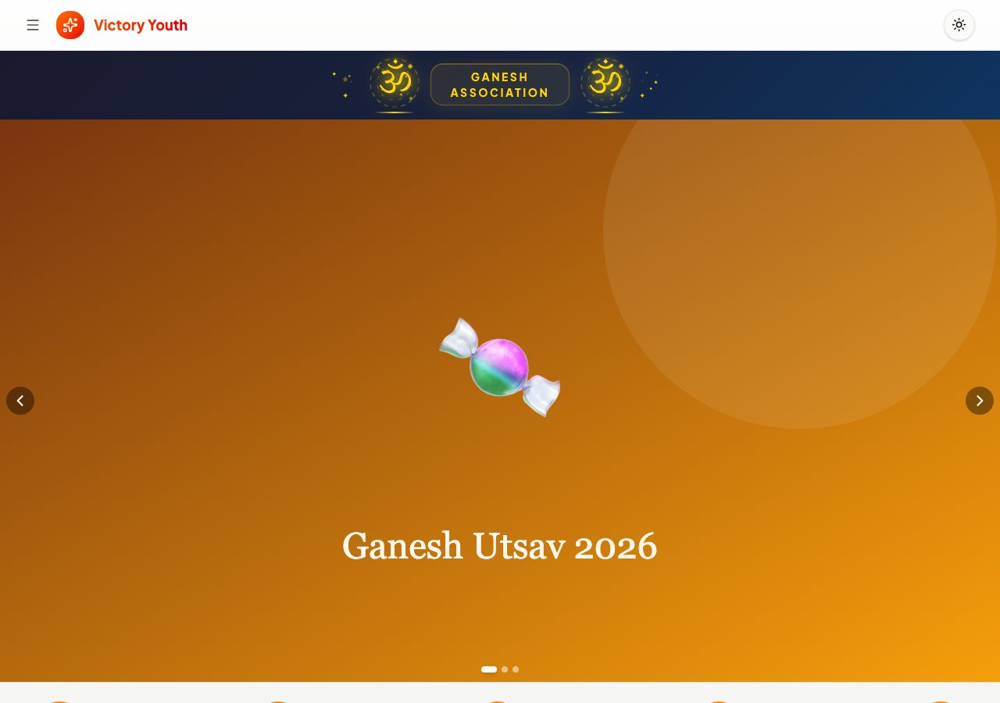
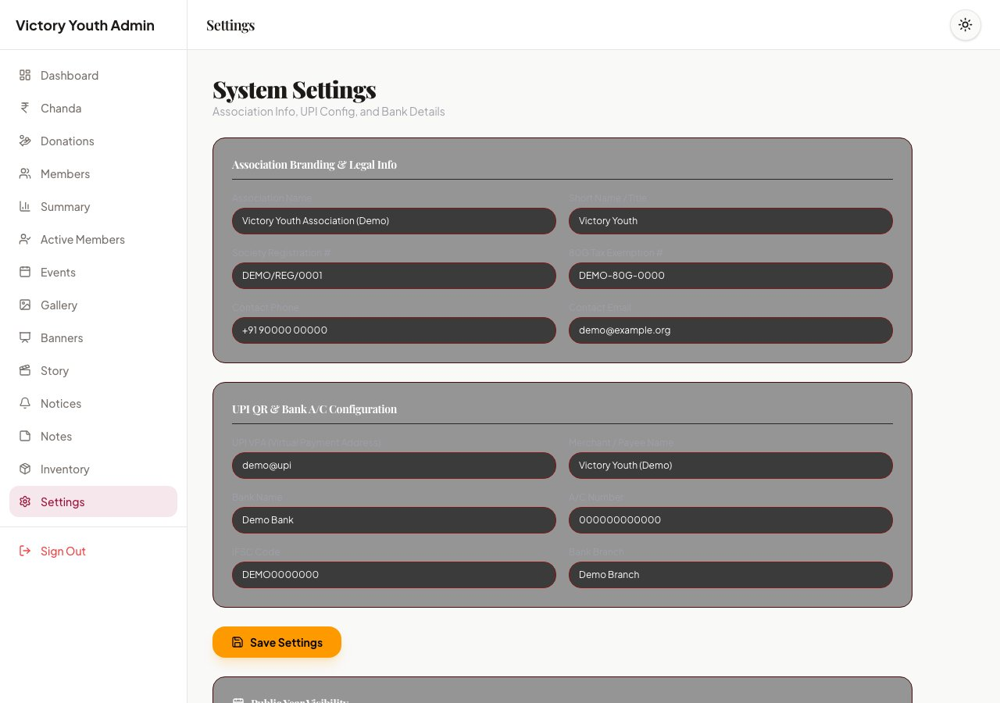

# Run it for your own association

Victory Youth is a **GitHub template**. Any youth group, temple committee or
small NGO can copy it onto free tiers and run their own festival and donation
site. This guide is for non-developers as well as maintainers.

You do **not** need accounts to try the software first. Use the local demo,
then create accounts only when you are ready to go live.



## 1. Try it locally (no accounts)

Need Node.js 22+.

```bash
git clone https://github.com/SandeepAi369/victory-youth.git
cd victory-youth
npm install
npm run demo
```

Open http://localhost:3000. Sign in to the admin panel at `/login` with the
password `demo-admin-password`. Everything lives under `.demo/` and never
touches a real database. See [CONTRIBUTING.md](../CONTRIBUTING.md).

## 2. Make your own copy

1. Open https://github.com/SandeepAi369/victory-youth
2. Click **Use this template** → **Create a new repository**
3. Choose your organisation or account, pick a name, create the repo
4. Clone your new repository and continue below

## 3. Create the free accounts

You need three free accounts before a cloud setup:

| Service | Why | Sign up |
|---|---|---|
| [Turso](https://turso.tech) | Core database (money, members, events, settings) | Free tier |
| [Cloudflare](https://dash.cloudflare.com) | Hosts the site (Workers) and the media database (D1) | Free tier |
| [Cloudinary](https://cloudinary.com) | Image uploads from the browser | Free tier |

Also install the [Turso CLI](https://docs.turso.tech/cli/introduction) and log
in once:

```bash
turso auth login
npx wrangler login
```

## 4. One-command setup and first deploy

From your clone:

```bash
npm install
npm run setup              # creates Turso + D1, writes .env and wrangler.jsonc
npm run deploy             # build for Workers and publish with wrangler
```

`npm run setup` never overwrites existing `.env` values. Add `--dry-run` first
if you want to see the commands without running them. All variables are listed
in [`.env.example`](../.env.example).

For browser image uploads, set an **unsigned** Cloudinary upload preset and
put `NEXT_PUBLIC_CLOUDINARY_CLOUD_NAME` and
`NEXT_PUBLIC_CLOUDINARY_UPLOAD_PRESET` in `.env` (or edit the defaults in
`src/lib/cloudinary-config.ts`).

Optional: push to `main` and let GitHub Actions deploy for you. Add the
repository secret `CLOUDFLARE_API_TOKEN` and set Worker secrets with
`npx wrangler secret put …` as described in the README **Deployment** section.

## 5. Put your association on the site

Sign in at `/login` with the admin password from setup, then open
**Settings** (`/admin/settings`).



### Name, 80G and payments

In **Association Branding & Legal Info** and **UPI QR & Bank A/C Configuration**:

- Association name and short title (shown on the public site)
- Society registration number and **80G** tax exemption number
- Contact phone and email
- **UPI** VPA and payee name (for the donor QR)
- Bank name, account number, IFSC and branch

Click **Save Settings**. Empty fields are stored as empty so old demo values
do not linger.

### Logo, banners and look

- Upload **banners / hero images** under **Admin → Banners** (and gallery
  photos under **Gallery**). Images go straight to Cloudinary; the database
  keeps only the URL.
- Switch light and dark theme with the sun / moon control in the admin header.
  Association brand colours for events and UI accents are edited with those
  records in admin, not on the Settings form.

Year visibility for public money pages is on the same Settings screen under
**Public Page Visibility**.

## 6. Checklist before you invite donors

- [ ] Association name and short title are yours, not the demo defaults
- [ ] 80G and UPI / bank details are correct
- [ ] Admin password is strong and stored only as a Worker secret
- [ ] Cloudinary uploads work from the admin gallery or banners page
- [ ] Public pages show the years you intend (Settings → year visibility)

## Where to read next

- Full install options (local without cloud, scripts table): README
  [Getting started](../README.md#getting-started)
- Automated deploy and Worker secrets: README
  [Deployment](../README.md#deployment)
- How to contribute code: [CONTRIBUTING.md](../CONTRIBUTING.md)
